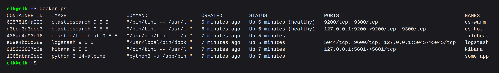
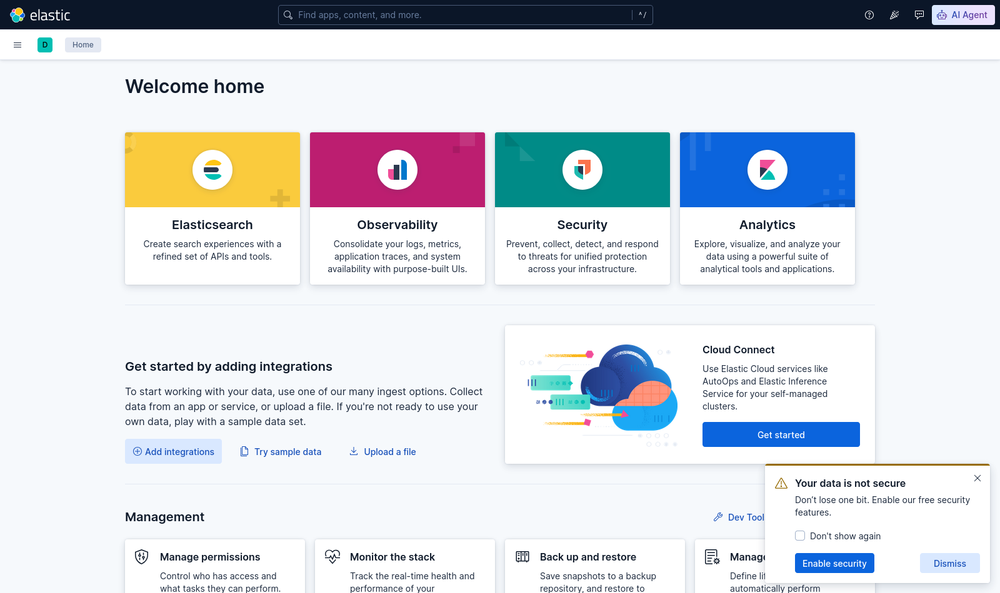
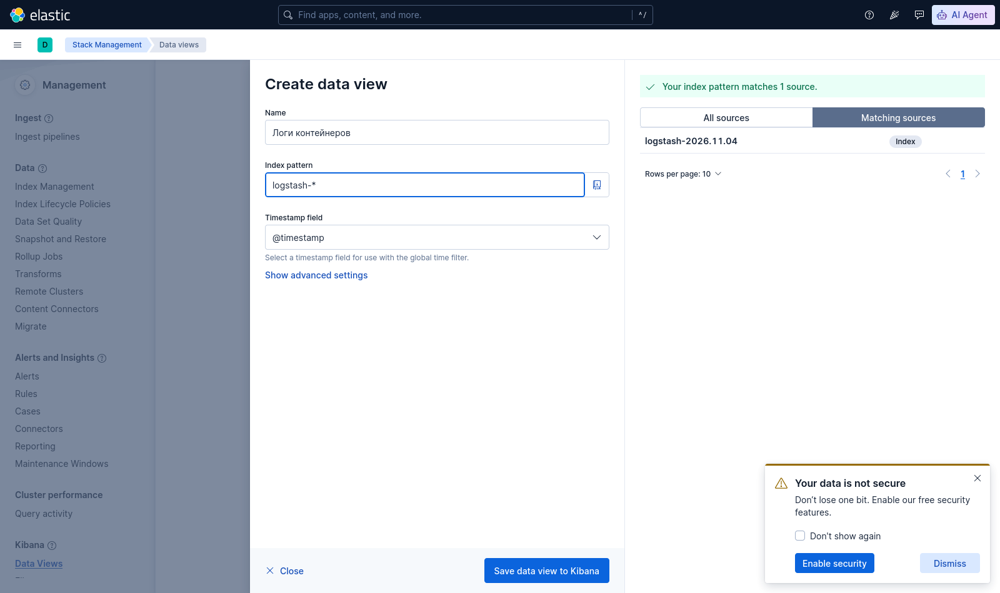
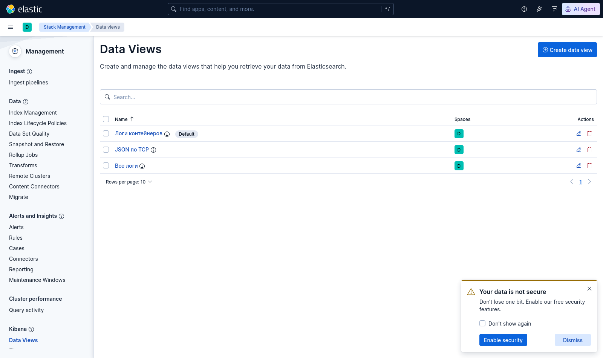
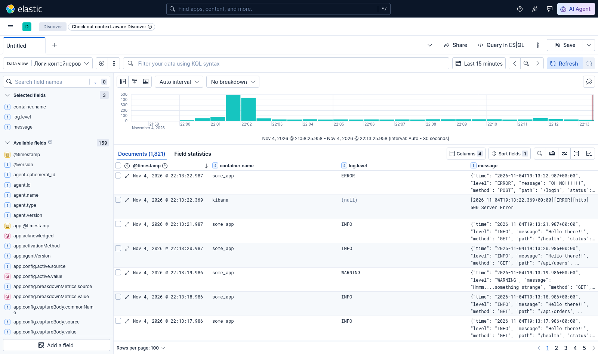

# Домашнее задание к занятию 15 «Система сбора логов Elastic Stack - Викторов Михаил»

## Файлы

<details><summary>compose.yaml</summary>

```yaml
# Стек логов: Elasticsearch (hot + warm) <- Logstash <- Filebeat (логи всех контейнеров Docker), Kibana.
# Наружу ничего не публикуется: порты только на 127.0.0.1, Kibana смотрим через SSH-туннель.
# Перед запуском на хосте: sysctl -w vm.max_map_count=262144 (на ВМ - через cloud-init).
name: elk

x-es: &es
  image: elasticsearch:9.5.5
  ulimits:
    memlock: {soft: -1, hard: -1}
    nofile: {soft: 65536, hard: 65536}
  healthcheck:
    # адрес в кавычках: иначе shell считает & концом команды и проверка «проходит» сразу
    test: ["CMD-SHELL", "curl -sf 'http://localhost:9200/_cluster/health?wait_for_status=yellow&timeout=5s' >/dev/null"]
    interval: 10s
    timeout: 10s
    retries: 30
  restart: unless-stopped

x-es-env: &es-env
  cluster.name: netology-elk
  discovery.seed_hosts: es-hot,es-warm
  cluster.initial_master_nodes: es-hot,es-warm
  bootstrap.memory_lock: "true"
  # стенд учебный и закрыт от сети: без паролей и TLS (в бою security не выключать)
  xpack.security.enabled: "false"
  ES_JAVA_OPTS: -Xms1g -Xmx1g

services:
  es-hot:
    <<: *es
    container_name: es-hot
    environment:
      <<: *es-env
      node.name: es-hot
      # горячая нода: свежие индексы, сюда пишет Logstash
      node.roles: master,ingest,data_content,data_hot
    volumes:
      - es_hot:/usr/share/elasticsearch/data
    ports:
      - 127.0.0.1:9200:9200

  es-warm:
    <<: *es
    container_name: es-warm
    environment:
      <<: *es-env
      node.name: es-warm
      # тёплая нода: индексы, которые уже не пишутся, переезжают сюда по политике ILM
      node.roles: master,data_warm
    volumes:
      - es_warm:/usr/share/elasticsearch/data

  # разовая настройка кластера: политика hot -> warm и шаблон индексов логов; после неё контейнер завершается
  es-setup:
    image: elasticsearch:9.5.5
    container_name: es-setup
    entrypoint: ["bash", "/setup/init.sh"]
    volumes:
      - ./setup:/setup:ro
    depends_on:
      es-hot: {condition: service_healthy}
      es-warm: {condition: service_healthy}
    restart: "no"

  logstash:
    image: logstash:9.5.5
    container_name: logstash
    environment:
      LS_JAVA_OPTS: -Xms512m -Xmx512m
    volumes:
      - ./logstash/config/logstash.yml:/usr/share/logstash/config/logstash.yml:ro
      - ./logstash/pipeline:/usr/share/logstash/pipeline:ro
    ports:
      - 127.0.0.1:5045:5045   # приём JSON по TCP
    depends_on:
      es-setup: {condition: service_completed_successfully}
    restart: unless-stopped

  kibana:
    image: kibana:9.5.5
    container_name: kibana
    environment:
      ELASTICSEARCH_HOSTS: '["http://es-hot:9200","http://es-warm:9200"]'
      TELEMETRY_OPTIN: "false"
    ports:
      - 127.0.0.1:5601:5601
    depends_on:
      es-hot: {condition: service_healthy}
    restart: unless-stopped

  filebeat:
    image: elastic/filebeat:9.5.5
    container_name: filebeat
    user: root   # читать /var/lib/docker/containers может только root
    # конфиг смонтирован с хоста и принадлежит не root - отключаем проверку владельца
    command: ["filebeat", "-e", "--strict.perms=false"]
    volumes:
      - ./filebeat/filebeat.yml:/usr/share/filebeat/filebeat.yml:ro
      - /var/lib/docker/containers:/var/lib/docker/containers:ro
      - /var/run/docker.sock:/var/run/docker.sock:ro
      - filebeat_data:/usr/share/filebeat/data
    depends_on:
      - logstash
    restart: unless-stopped

  # тестовое приложение: раз в секунду пишет в stdout событие в JSON
  some_app:
    image: python:3.14-alpine
    container_name: some_app
    command: ["python3", "-u", "/app/pinger.py"]
    volumes:
      - ./app:/app:ro
    restart: unless-stopped

volumes:
  es_hot:
  es_warm:
  filebeat_data:
```
</details>

<details><summary>logstash/pipeline/logstash.conf</summary>

```
input {
  # логи контейнеров от Filebeat (протокол beats)
  beats {
    port => 5044
    tags => ["docker"]
  }
  # JSON-сообщения по TCP: одна строка - один JSON-объект
  tcp {
    port => 5045
    codec => json_lines
    tags => ["tcp-json"]
  }
}

filter {
  if "docker" in [tags] {
    # приложения пишут в stdout JSON-строки - разбираем их в поле app
    if [message] =~ /^\s*\{/ {
      json {
        source => "message"
        target => "app"
        skip_on_invalid_json => true
      }
    }
    # уровень из лога приложения - в стандартное поле ECS log.level, его подсвечивает Kibana
    if [app][level] {
      mutate {
        add_field => { "[log][level]" => "%{[app][level]}" }
      }
    }
  }
}

output {
  if "tcp-json" in [tags] {
    elasticsearch {
      hosts => ["http://es-hot:9200"]
      index => "json-tcp-%{+yyyy.MM.dd}"
      manage_template => false
    }
  } else {
    elasticsearch {
      hosts => ["http://es-hot:9200"]
      index => "logstash-%{+yyyy.MM.dd}"
      manage_template => false
    }
  }
}
```
</details>

<details><summary>logstash/config/logstash.yml</summary>

```yaml
# API мониторинга Logstash - только внутри контейнера
api.http.host: 127.0.0.1
# перечитывать pipeline при изменении файлов
config.reload.automatic: true
```
</details>

<details><summary>filebeat/filebeat.yml</summary>

```yaml
filebeat.inputs:
  # json-файлы логов Docker всех контейнеров машины
  - type: filestream
    id: docker-containers
    paths:
      - /var/lib/docker/containers/*/*.log
    parsers:
      - container: ~

processors:
  # имя контейнера, образ, метки - из API Docker
  - add_docker_metadata:
      host: unix:///var/run/docker.sock
  # свои логи не отправляем: filebeat пишет о каждой отправке, и это превращается в петлю
  - drop_event:
      when:
        equals:
          container.name: filebeat

output.logstash:
  hosts: ["logstash:5044"]

logging.level: info
logging.metrics.enabled: false
```
</details>

<details><summary>setup/init.sh - политика ILM и шаблон индексов</summary>

```bash
#!/bin/bash
# Разовая настройка кластера: политика жизненного цикла hot -> warm и шаблон для индексов логов.
set -euo pipefail
ES=http://es-hot:9200

put() {
  echo "PUT $1"
  curl -sf -X PUT "$ES/$1" -H 'Content-Type: application/json' -d "$2"
  echo
}

# ILM по умолчанию проверяет индексы раз в 10 минут; для учебного стенда - раз в минуту
put _cluster/settings '{"persistent": {"indices.lifecycle.poll_interval": "1m"}}'

# Индекс живёт на горячей ноде, через 5 минут после создания переезжает на тёплую (действие migrate
# в фазе warm добавляется автоматически), через 7 дней удаляется.
# В бою вместо 5 минут - сутки: вчерашний дневной индекс уже не пишется и уходит на warm.
put _ilm/policy/logs-hot-warm '{
  "policy": {
    "phases": {
      "hot":    {"actions": {"set_priority": {"priority": 100}}},
      "warm":   {"min_age": "5m", "actions": {"set_priority": {"priority": 50}}},
      "delete": {"min_age": "7d", "actions": {"delete": {}}}
    }
  }
}'

# Шаблон для индексов логов: 1 шард без реплик (горячая нода одна - реплике негде жить), политика ILM,
# типы полей приложения, чтобы по ним можно было искать диапазоном (app.status >= 500).
# Имя не "logs": так называется встроенный шаблон Elasticsearch, и он перезаписывает одноимённый свой.
put _index_template/netology-logs '{
  "index_patterns": ["logstash-*", "json-tcp-*"],
  "priority": 200,
  "template": {
    "settings": {
      "number_of_shards": 1,
      "number_of_replicas": 0,
      "index.lifecycle.name": "logs-hot-warm"
    },
    "mappings": {
      "properties": {
        "app": {
          "properties": {
            "status":      {"type": "integer"},
            "duration_ms": {"type": "integer"},
            "level":       {"type": "keyword"}
          }
        }
      }
    }
  }
}'
# индексы, созданные до шаблона (если стек перезапускается), - те же настройки
put "logstash-*,json-tcp-*/_settings?allow_no_indices=true" '{"index": {"number_of_replicas": 0, "lifecycle.name": "logs-hot-warm"}}'
echo "готово"
```
</details>

<details><summary>app/pinger.py - тестовое приложение</summary>

```python
#!/usr/bin/env python3
"""Тестовое приложение: раз в секунду пишет в stdout событие в JSON, похожее на лог веб-сервиса."""
import json
import random
import time
from datetime import datetime, timezone

PATHS = ["/", "/api/orders", "/api/users", "/login", "/health"]
MESSAGES = {
    "INFO": "Hello there!!",
    "WARNING": "Hmmm....something strange",
    "ERROR": "OH NO!!!!!!",
}

while True:
    status = random.choices([200, 201, 301, 404, 500], weights=[60, 10, 10, 12, 8])[0]
    level = "ERROR" if status >= 500 else "WARNING" if status >= 400 else "INFO"
    event = {
        "time": datetime.now(timezone.utc).isoformat(timespec="milliseconds"),
        "level": level,
        "message": MESSAGES[level],
        "method": random.choice(["GET", "GET", "POST"]),
        "path": random.choice(PATHS),
        "status": status,
        "duration_ms": random.randint(3, 900),
        "user_id": random.randint(1, 50),
    }
    if status >= 500:
        event["error"] = "Exception: this is exception"
    print(json.dumps(event), flush=True)
    time.sleep(1)
```
</details>

<details><summary>yc/vm.sh и yc/cloud-init.yaml - ВМ в Yandex Cloud</summary>

```bash
#!/bin/bash
# Временная ВМ под стек ELK в учебном облаке: ./vm.sh create | delete
set -euo pipefail
cd "$(dirname "$0")"
YC="yc --profile hw"
ZONE=ru-central1-d  # в учебном облаке квоты на диски есть только в зоне d
MYIP="${MYIP:-$(curl -4 -s https://ifconfig.me)}"   # SSH пускаем только с этого адреса

case "${1:-}" in
create)
  $YC vpc network create --name elk-net
  $YC vpc subnet create --name elk-subnet --network-name elk-net --zone $ZONE --range 10.10.0.0/24
  $YC vpc security-group create --name elk-sg --network-name elk-net \
    --rule "direction=ingress,port=22,protocol=tcp,v4-cidrs=[$MYIP/32]" \
    --rule "direction=egress,from-port=0,to-port=65535,protocol=any,v4-cidrs=[0.0.0.0/0]"
  $YC compute instance create --name elk --hostname elk --zone $ZONE \
    --platform standard-v3 --cores 4 --core-fraction 50 --memory 8 --preemptible \
    --create-boot-disk image-family=ubuntu-2604-lts,image-folder-id=standard-images,size=20,type=network-hdd \
    --network-interface subnet-name=elk-subnet,nat-ip-version=ipv4,security-group-ids=$($YC vpc security-group get elk-sg --format json | python3 -c 'import sys,json; print(json.load(sys.stdin)["id"])') \
    --metadata-from-file user-data=<(SSH_PUBKEY="$(cat ~/.ssh/yc_hw.pub)" envsubst < cloud-init.yaml)
  ;;
delete)
  $YC compute instance delete elk || true
  $YC vpc security-group delete elk-sg || true
  $YC vpc subnet delete elk-subnet || true
  $YC vpc network delete elk-net || true
  ;;
*) echo "usage: $0 create|delete"; exit 1 ;;
esac
```

```yaml
#cloud-config
users:
  - name: elk
    groups: sudo
    shell: /bin/bash
    sudo: ALL=(ALL) NOPASSWD:ALL
    ssh_authorized_keys:
      - ${SSH_PUBKEY}
write_files:
  - path: /etc/sysctl.d/90-elasticsearch.conf
    content: |
      vm.max_map_count = 262144
runcmd:
  - sysctl --system
  - curl -fsSL https://get.docker.com | sh
  - usermod -aG docker elk
```
</details>

---

## Задание 1

Вам необходимо поднять в докере и связать между собой:

- elasticsearch (hot и warm ноды);
- logstash;
- kibana;
- filebeat.

Logstash следует сконфигурировать для приёма по tcp json-сообщений.

Filebeat следует сконфигурировать для отправки логов docker вашей системы в logstash.

В директории [help](./help) находится манифест docker-compose и конфигурации filebeat/logstash для быстрого 
выполнения этого задания.

Результатом выполнения задания должны быть:

- скриншот `docker ps` через 5 минут после старта всех контейнеров (их должно быть 5);
- скриншот интерфейса kibana;
- docker-compose манифест (если вы не использовали директорию help);
- ваши yml-конфигурации для стека (если вы не использовали директорию help).

## Ответ

`docker ps` через 5 минут после старта. Контейнеров шесть: пять компонентов стека (es-hot, es-warm, logstash,
kibana, filebeat) и тестовое приложение some_app:



Интерфейс Kibana:



## Задание 2

Перейдите в меню [создания index-patterns  в kibana](http://localhost:5601/app/management/kibana/indexPatterns/create) и создайте несколько index-patterns из имеющихся.

Перейдите в меню просмотра логов в kibana (Discover) и самостоятельно изучите, как отображаются логи и как производить поиск по логам.

## Ответ

В Kibana 8+ index patterns называются **data views** (Stack Management → Data Views). Создал три:
«Логи контейнеров» (`logstash-*`), «JSON по TCP» (`json-tcp-*`) и «Все логи» (`logstash-*,json-tcp-*`):





Индекс `logstash-*` появился сразу: Logstash пишет в `logstash-%{+yyyy.MM.dd}`, а тестовое приложение выдаёт событие каждую секунду. 

Все логи контейнеров за 15 минут - гистограмма по времени, слева поля, справа документы:


